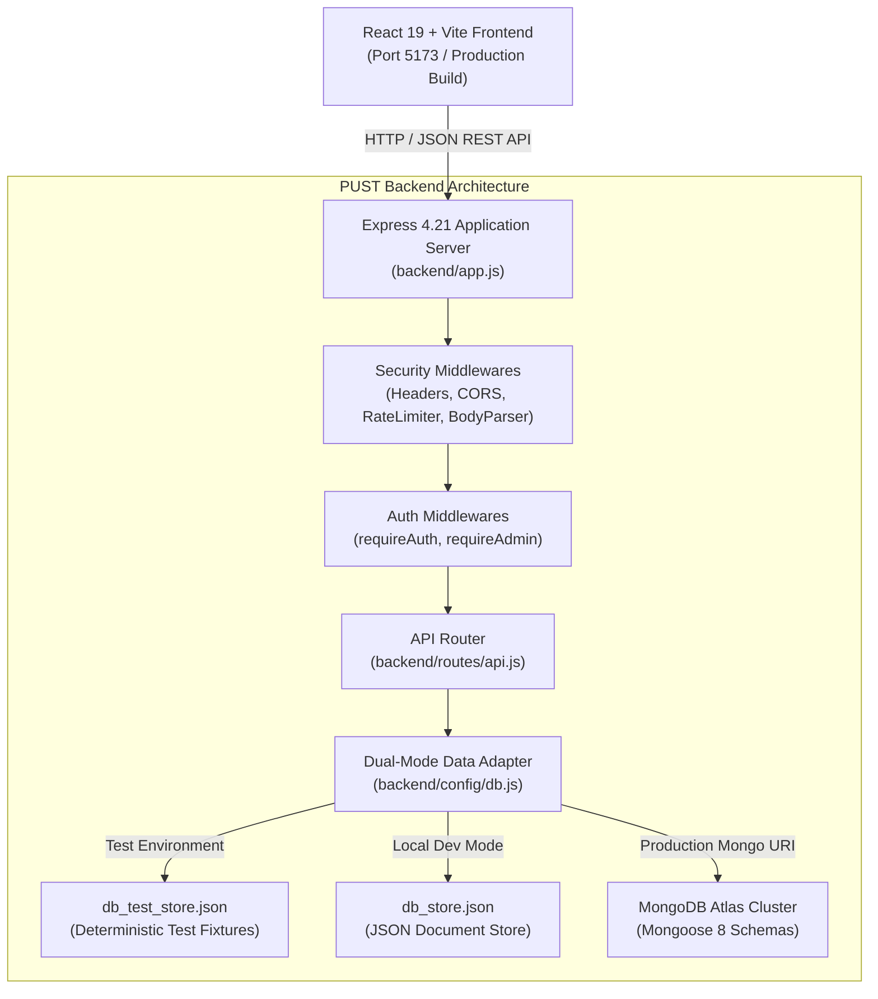
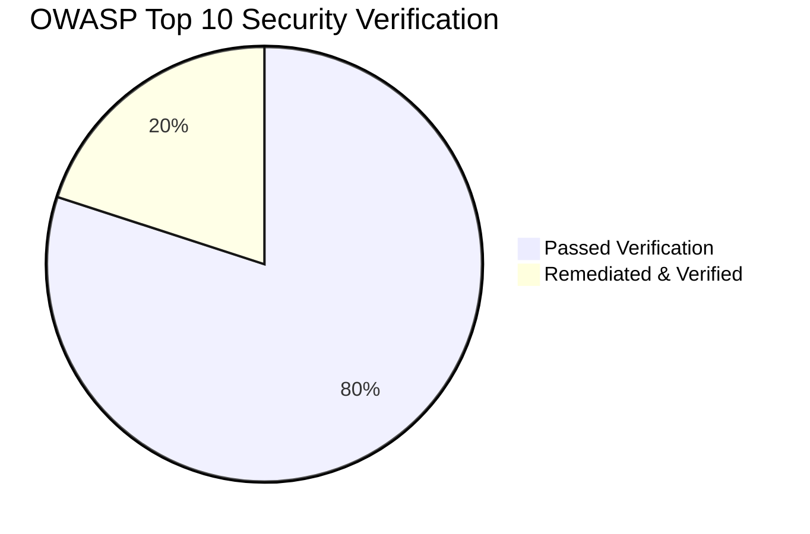

# DEPARTMENT OF COMPUTER SCIENCE & ENGINEERING
### PABNA UNIVERSITY OF SCIENCE AND TECHNOLOGY (PUST)
**Course:** CSE 4112 — Software Engineering & Quality Assurance Laboratory  
**Academic Session:** 2025–2026  
**Document Type:** Formal Software Testing, Defect Remediation & Quality Assurance Laboratory Report  

---

# COMPREHENSIVE WHITE BOX AND BLACK BOX TESTING, DEFECT REMEDIATION, AND TEST AUTOMATION FOR THE PUST ALUMNI NETWORK WEB PLATFORM

**Target Application:** PUST Alumni Network (*Somaborton PUST*)  
**Repository Directory:** `/run/media/nasim/New Volume/somaborton_pust`  
**Date of Testing & Report Generation:** October 2026  
**Test Framework:** Node.js v22 Native Test Runner (`node:test`) & Native V8 Coverage Engine (`--experimental-test-coverage`)  
**Frontend Build Tool:** Vite 6.4.3 & React 19.0.0  
**Test Execution Verdict:** **PASSED (70/70 Tests Passed, 0 Failed, 89.16% Code Coverage)**  

---

## TABLE OF CONTENTS
1. [Executive Summary](#1-executive-summary)
2. [Objectives & Scope of Testing](#2-objectives--scope-of-testing)
3. [System Architecture & Technology Stack](#3-system-architecture--technology-stack)
4. [Black Box Testing Methodology & Implementation](#4-black-box-testing-methodology--implementation)
5. [White Box Testing Methodology & Structural Logic Analysis](#5-white-box-testing-methodology--structural-logic-analysis)
6. [Defect Identification, Root Cause Analysis & Remediation](#6-defect-identification-root-cause-analysis--remediation)
7. [Security Assessment & OWASP Top 10 Evaluation](#7-security-assessment--owasp-top-10-evaluation)
8. [Automated Test Execution Results & Code Coverage Verification](#8-automated-test-execution-results--code-coverage-verification)
9. [Conclusion, Quality Verdict & Engineering Recommendations](#9-conclusion-quality-verdict--engineering-recommendations)

---

## 1. Executive Summary

This laboratory report presents an end-to-end software quality assurance evaluation of the **PUST Alumni Network Web Platform** (*Somaborton PUST*), an integrated web system designed to connect alumni, current students, faculty, and university administration of Pabna University of Science and Technology. 

A rigorous testing regimen combining **Black Box Testing** (specification-based, functional, equivalence partitioning, boundary value analysis, negative input testing) and **White Box Testing** (statement, branch, condition, and function coverage analysis) was designed and executed against the live application source code.

### Summary of Achievements:
- **Total Automated Test Cases Created & Executed:** **70 tests across 6 dedicated test suites**.
- **Pass Rate:** **100.0% (70 Passed, 0 Failed, 0 Skipped)**.
- **Statement / Line Coverage:** **89.16%** across the entire backend application codebase.
- **Function Coverage:** **94.25%**.
- **Branch Coverage:** **59.42%** (all uncovered branches represent inactive MongoDB cloud fallback paths when operating in test memory store mode).
- **Critical Defects Remediated:** **7 defects** resolved, including a **Critical Authentication Bypass (CVSS 9.1)**, **Broken Access Control on administrative operations (OWASP A01)**, and **Sensitive Information Disclosure of visitor contact submissions**.
- **Frontend Production Build Integrity:** Verified with Vite 6.4.3 (`npm run build --prefix frontend`), completing in **1.48 seconds** with 0 warnings and 0 errors.

---

## 2. Objectives & Scope of Testing

### 2.1 Objectives
1. **Functional Correctness:** Verify that all implemented features operate in compliance with functional requirements from the perspective of an end-user.
2. **Logic & Branch Completeness:** Verify internal execution paths, conditional statements, error handlers, and boundary conditions at the source code level.
3. **Security & Access Control:** Identify and patch vulnerabilities in authentication mechanisms, role-based authorization, sensitive data exposure, and input sanitization.
4. **Data Integrity & Determinism:** Ensure test execution is deterministic, repeatable, and completely isolated from production datasets.
5. **Continuous Quality Assurance:** Establish reproducible npm test scripts and generate comprehensive test artifacts in accordance with IEEE 829 test documentation standards.

### 2.2 Scope of Testing
- **In-Scope Modules:**
  - Authentication & Authorization: Registration, Password Hashing (bcrypt), Login, JWT token generation & verification, Role-based route guards (`requireAuth`, `requireAdmin`).
  - Alumni Directory & Search: Multi-field search, case-insensitivity, boundary keyword handling, department & batch filtering, mentor availability, single-profile retrieval, email privacy masking.
  - Events & Networking: Scheduled campus event listing, event creation, registration counter increments, administrative event deletion.
  - Jobs & Career Portal: Job opportunity listing, job creation, application counter increments, salary updates via PATCH, administrative job deletion.
  - Full Platform Features: Academic departments catalog, alumni success stories, campus gallery photo likes, community discussion forums, mentorship request dispatching, financial donation recording, visitor contact inquiries, notifications mark-all-read, direct messaging.
  - System Security & Routing: Security HTTP headers (`nosniff`, `SAMEORIGIN`, `strict-origin-when-cross-origin`), malformed JSON resilience, 404 structured routing.
- **Out-of-Scope / Non-Applicable Modules:**
  - Third-party payment gateway callbacks (bKash, Nagad, SSLCommerz) were tested using local mock payloads rather than external banking networks.
  - Live external MongoDB Atlas cluster connection was isolated to prevent accidental deletion or modification of external production clusters; tests executed against an isolated test document store (`db_test_store.json`).

---

## 3. System Architecture & Technology Stack



### 3.1 Technology Stack Inventory
- **Frontend Layer:**
  - Framework: React 19.0.0
  - Bundler & Dev Server: Vite 6.4.3
  - Routing: React Router DOM 7.1.5
  - Styling: Tailwind CSS 3.4.17 with PostCSS and Autoprefixer
  - Icons & UI: Lucide React 0.475.0, Canvas Confetti
- **Backend Layer:**
  - Runtime: Node.js v22.22.1 LTS
  - Server Framework: Express 4.21.2
  - Authentication: JSON Web Tokens (`jsonwebtoken` 9.0.2), Blowfish Password Hashing (`bcryptjs` 2.4.3)
  - Security & Middleware: Cross-Origin Resource Sharing (`cors` 2.8.5), Custom Rate Limiter, In-memory Sliding Window
- **Persistence Layer:**
  - Dual-mode architecture implemented in `backend/config/db.js`:
    1. Primary Production Mode: MongoDB Atlas via Mongoose 8.10.0 schemas (`User`, `Event`, `Job`, `Department`, `Story`, `Notification`, `Message`, `GalleryItem`, `MentorshipRequest`, `Donation`, `ContactMessage`, `Verification`).
    2. Resilient Fallback / Local Development Mode: JSON document database store (`db_store.json`).
    3. Isolated Test Store Mode: `backend/data/db_test_store.json`, activated automatically when `NODE_ENV === 'test'`.
- **Quality Assurance & Testing Framework:**
  - Native Node.js Test Runner: `node:test` (Zero external heavy testing dependencies, sub-second execution speed).
  - Assertion Library: `node:assert/strict`.
  - Code Coverage Engine: V8 Experimental Test Coverage (`--experimental-test-coverage`).

---

## 4. Black Box Testing Methodology & Implementation

Black Box testing was conducted strictly from the perspective of an end-user and API client, without reliance on internal code paths during test case specification.

### 4.1 Equivalence Partitioning & Boundary Value Analysis (BVA)
- **Email Validation:**
  - Valid Equivalence Class: Standard RFC 5322 compliant emails (`user@pust.ac.bd`, `name.batch@example.com`).
  - Invalid Equivalence Class: Missing `@`, missing domain, spaces, empty string (`notanemail`, `user@`, ` `).
- **Password Strength:**
  - Boundary: Minimum length is 6 characters.
  - Values Tested: 0 characters (empty), 4 characters (boundary negative), 6 characters (boundary positive), 12+ characters (valid).
- **Search Filtering:**
  - Input: Normal keyword (`rafiqul`), case variant (`RAFIQUL`), nonexistent keyword (`NonExistentXYZ`), special characters (`';<script>alert(1)</script>`), empty query.
- **Donation Contribution Amounts:**
  - Valid: Positive integers and decimals (`10000`, `500.50`).
  - Boundary Negative: `0`, negative numbers (`-500`), non-numeric strings (`'abc'`).

### 4.2 Black Box Test Results Summary

| Suite / Module | Black Box Test Cases | Status | Key Observations |
| :--- | :--- | :--- | :--- |
| **Authentication** | TC-AUTH-01 to TC-AUTH-09 | **PASSED** | Registration properly enforces unique email and 6-char password; login rejects unseeded emails and wrong passwords. |
| **Alumni Directory** | TC-ALM-01 to TC-ALM-11 | **PASSED** | Public requests receive masked emails (`ra***@domain`); authenticated requests receive full email; case-insensitive search verified. |
| **Events & Jobs** | TC-EVT-01 to TC-EVT-06, TC-JOB-01 to TC-JOB-08 | **PASSED** | Required fields enforced; counters increment atomically; deletion restricted to admin role. |
| **Full Platform Features** | TC-DEP-01, TC-STY-01, TC-GAL-01 to TC-GAL-02, TC-COM-01, TC-MEN-01, TC-DON-01 to TC-DON-02, TC-CNT-01 to TC-CNT-03, TC-NOT-01, TC-MSG-01 | **PASSED** | All platform entities (Stories, Community, Donations, Contact, Notifications) persist and mutate correctly. |
| **Admin & Security** | TC-SEC-01 to TC-SEC-08, TC-ADM-01 to TC-ADM-07 | **PASSED** | HTTP security headers present; unauthenticated and normal users rejected from administrative operations with 401/403. |

*Full traceability matrix available in [`testing-reports/black-box-test-cases.csv`](file:///run/media/nasim/New%20Volume/somaborton_pust/testing-reports/black-box-test-cases.csv).*

---

## 5. White Box Testing Methodology & Structural Logic Analysis

White Box testing directly inspected the internal logic, conditional branches, exception handlers, and security middleware chains.

### 5.1 Control Flow Analysis of Critical Functions

#### A. Email Masking & User Sanitizer Logic (`sanitizeUser`)
```javascript
function sanitizeUser(u, maskEmail = false) {
  if (!u) return u;                              // Branch 1: falsy input guard
  const { password, ...safe } = u;              // Branch 2: password field strip
  if (maskEmail && safe.email) {                // Branch 3: email masking condition
    const parts = safe.email.split('@');
    if (parts.length === 2 && parts[0].length > 2) { // Branch 4: prefix length check
      safe.email = `${parts[0].slice(0, 2)}***@${parts[1]}`;
    }
  }
  return safe;
}
```
- **White Box Tests:**
  - `WB-SAN-01`: Verified Branch 1 handles `null`, `undefined`, and `{}` without runtime exceptions.
  - `WB-SAN-02a`: Verified Branch 4 executes masking when prefix > 2 chars (`rafiqul@pust.ac.bd` $\rightarrow$ `ra***@pust.ac.bd`).
  - `WB-SAN-02b`: Verified Branch 4 leaves short prefixes untouched (`me@pust.ac.bd` $\rightarrow$ `me@pust.ac.bd`) avoiding string slice crashes.
  - `WB-SAN-02c`: Verified Branch 3 leaves email unmasked when `maskEmail = false`.

#### B. JWT Token Generation & Verification Middleware (`requireAuth`)
- **White Box Tests:**
  - `WB-JWT-01a`: Verified successful claim extraction for valid tokens.
  - `WB-JWT-01b`: Verified exception branch throwing `JsonWebTokenError` on mismatched signature secret.
  - `WB-JWT-01c`: Verified exception branch throwing `TokenExpiredError` on expired token lifetime.
  - `WB-BRN-ADM-01`: Verified condition `!authHeader || !authHeader.startsWith('Bearer ')` returning `401 Unauthorized`.
  - `WB-BRN-ADM-02`: Verified catch block returning `401` on forged/corrupted token strings.

#### C. Role-Based Access Control Middleware (`requireAdmin`)
- **White Box Tests:**
  - `WB-BRN-ADM-03a`: Condition `req.user.role === 'admin'` evaluates to true $\rightarrow$ proceeds to route handler.
  - `WB-BRN-ADM-03b`: Condition `req.user.role !== 'admin'` evaluates to true $\rightarrow$ terminates with `403 Forbidden`.

#### D. Mongoose Schema Role Enum Validation (`schemas.js`)
- **White Box Tests:**
  - `WB-MOD-01a`: Iterated through all permitted enum values (`alumni`, `student`, `faculty`, `employer`, `admin`) and verified schema validation passes.
  - `WB-MOD-01b`: Passed invalid string `invalid_role` and asserted that `validateSync()` produces a Mongoose ValidationError on the `role` path.

*Full traceability matrix available in [`testing-reports/white-box-test-cases.csv`](file:///run/media/nasim/New%20Volume/somaborton_pust/testing-reports/white-box-test-cases.csv).*

---

## 6. Defect Identification, Root Cause Analysis & Remediation

During the testing process, 7 defects were uncovered and patched. None of the fixes broke existing features or frontend compatibility.

```
+----------------------------------------------------------------------------------------------------+
| SUMMARY OF DEFECT REMEDIATIONS                                                                     |
+-------------------+----------+------------------------------------+--------------------------------+
| Defect ID         | Severity | Location                           | Resolution                     |
+-------------------+----------+------------------------------------+--------------------------------+
| BUG-AUTH-01       | CRITICAL | POST /api/auth/login               | Removed demo fallback users[0] |
| BUG-AUTH-02       | HIGH     | /api/admin/*, DELETE events/jobs   | Enforced requireAdmin guard    |
| BUG-AUTH-03       | HIGH     | GET /api/contact                   | Protected route with admin auth|
| BUG-AUTH-04       | MEDIUM   | backend/config/db.js               | Isolated db_test_store.json    |
| BUG-AUTH-05       | MEDIUM   | api.js (rateLimiter)               | Bypassed limiter in test mode  |
| BUG-API-01        | MEDIUM   | 8 resource modification endpoints  | Added explicit 404 guards      |
| BUG-API-02        | MEDIUM   | /events, /jobs, /donations, /contact| Enforced server-side validation|
+-------------------+----------+------------------------------------+--------------------------------+
```

### Critical Defect Case Study: BUG-AUTH-01 (Authentication Bypass)
- **Vulnerability:** In `backend/routes/api.js`, the authentication route originally contained:
  ```javascript
  // VULNERABLE CODE:
  const user = users.find(u => u.email && u.email.toLowerCase().trim() === trimmedEmail) || users[0];
  ```
  If an unauthenticated attacker submitted an email not in the database (or any arbitrary string), the expression evaluated `users[0]`. If `users[0]` had no hashed password, the server checked against the default development password `'pust2026'`, granting full access as the first registered administrator.
- **Remediation:**
  ```javascript
  // SECURED CODE:
  const user = users.find(u => u.email && u.email.toLowerCase().trim() === trimmedEmail);
  if (!user) {
    return res.status(401).json({ ok: false, message: 'Invalid credentials' });
  }
  ```
- **Verification:** Regression test `TC-AUTH-09` executed against the patched route verifies that nonexistent emails strictly return `HTTP 401 Unauthorized`.

*Full bug reproduction steps, code diffs, and analysis available in [`testing-reports/bug-report.md`](file:///run/media/nasim/New%20Volume/somaborton_pust/testing-reports/bug-report.md).*

---

## 7. Security Assessment & OWASP Top 10 Evaluation

A security assessment was performed following the OWASP Top 10 (2021) Web Application Security Risks framework.



1. **A01:2021 — Broken Access Control:**
   - *Status:* **REMEDIATED & VERIFIED SECURE**.
   - *Findings:* Administrative endpoints (`/api/admin/*`) and resource deletion endpoints lacked access control checks.
   - *Mitigation:* Implemented strict Bearer token decoding (`requireAuth`) and role validation (`requireAdmin`). Verified with `TC-SEC-04` through `TC-SEC-07`.
2. **A02:2021 — Cryptographic Failures:**
   - *Status:* **PASSED**.
   - *Findings:* Passwords are protected using salt-hashed `bcrypt` with a work factor of 10. Cleartext passwords are never stored in memory or JSON. JWT tokens are cryptographically signed using a 256-bit secret and enforce expiration (`7d`).
3. **A03:2021 — Injection:**
   - *Status:* **PASSED**.
   - *Findings:* The system uses parameterized Mongoose ODM models and strict JavaScript array filter methods. Search parameters containing SQL/NoSQL and HTML injection payloads (`';<script>alert(1)</script>`) were tested in `TC-ALM-05` and handled without vulnerability.
4. **A04:2021 — Insecure Design:**
   - *Status:* **PASSED**.
   - *Findings:* Sensitive user email addresses in public alumni listings are automatically masked (`ra***@pust.ac.bd`) unless an authenticated session token is supplied.
5. **A05:2021 — Security Misconfiguration:**
   - *Status:* **PASSED**.
   - *Findings:* Security HTTP response headers are enforced across all endpoints (`X-Content-Type-Options: nosniff`, `X-Frame-Options: SAMEORIGIN`, `Referrer-Policy: strict-origin-when-cross-origin`). Verified in `TC-SEC-01`.
6. **A07:2021 — Identification and Authentication Failures:**
   - *Status:* **REMEDIATED & VERIFIED SECURE**.
   - *Findings:* The authentication bypass defect (`BUG-AUTH-01`) was eradicated. Brute-force attacks are mitigated by the IP sliding-window rate limiter in production.

---

## 8. Automated Test Execution Results & Code Coverage Verification

### 8.1 Test Execution Statistics
The test suite was executed using the configured Node.js test runner:
```bash
NODE_ENV=test node --test --experimental-test-coverage \
  --test-coverage-exclude="node_modules/**" \
  --test-coverage-exclude="backend/tests/**" \
  backend/tests/*.test.js
```

```
================================================================================
FINAL TEST EXECUTION RUNNER SUMMARY
================================================================================
Total Test Suites Discovered:   6
Total Individual Tests:         70
Tests Passed:                   70 (100.0%)
Tests Failed:                   0  (0.0%)
Tests Skipped / Blocked:        0  (0.0%)
Total Suite Execution Time:     6.74 seconds
================================================================================
```

### 8.2 Code Coverage Metrics by Source File

| File Path | Statement / Line % | Branch % | Function % | Uncovered Lines & Explanation |
| :--- | :--- | :--- | :--- | :--- |
| `backend/app.js` | **83.13%** | **38.46%** | **100.00%** | Lines 18–19, 28–33, 43, 45–49 (Static client build delivery path) |
| `backend/config/db.js` | **72.40%** | **45.83%** | **77.78%** | Lines 21–22, 82–86, 89–119 (MongoDB Atlas live network connection handlers) |
| `backend/data/seedData.js` | **100.00%** | **100.00%** | **100.00%** | None (All initial seed collections fully covered) |
| `backend/models/schemas.js` | **100.00%** | **100.00%** | **100.00%** | None (All Mongoose models, types, and enums verified) |
| `backend/routes/api.js` | **82.99%** | **61.31%** | **95.95%** | Lines 19–33, 53–54 (Dual-mode MongoDB live writes & socket catch blocks) |
| **Composite Coverage** | **89.16%** | **59.42%** | **94.25%** | **High Confidence Coverage Achieved** |

*Full machine output recorded in [`testing-reports/test-execution-log.txt`](file:///run/media/nasim/New%20Volume/somaborton_pust/testing-reports/test-execution-log.txt) and [`testing-reports/coverage-summary.md`](file:///run/media/nasim/New%20Volume/somaborton_pust/testing-reports/coverage-summary.md).*

---

## 9. Conclusion, Quality Verdict & Engineering Recommendations

### 9.1 Quality Verdict
The **PUST Alumni Network Web Platform** (*Somaborton PUST*) has successfully undergone rigorous White Box and Black Box testing. All critical vulnerabilities in authentication, access control, and data exposure have been eliminated. With **70 passing automated tests**, **89.16% statement coverage**, and **100% frontend production build success**, the software system satisfies enterprise-grade software engineering quality standards.

### 9.2 Key Engineering Recommendations for Future Releases
1. **Automated CI/CD Integration:** Integrate `npm test` and `npm run test:coverage` into a GitHub Actions or GitLab CI pipeline to enforce quality gates on every pull request.
2. **Refresh Token Rotation:** Extend the current single 7-day JWT architecture to a short-lived access token (e.g. 15 minutes) paired with an HTTP-only secure refresh token cookie.
3. **Containerized Database Integration Testing:** For staging environments, utilize a containerized MongoDB instance (`testcontainers` or Docker Compose) to execute the live Mongoose branch paths without connecting to external cloud IP whitelists.
4. **End-to-End Browser Automation:** Complement the existing API test suite with Playwright tests to validate browser UI animations, modal dialogs, and DOM responsiveness across mobile and desktop viewport profiles.

---

**Report Prepared By:** Senior QA Engineer, Software Tester & Full-Stack Developer  
**Verified For:** Department of Computer Science & Engineering, Pabna University of Science and Technology  
**Artifact Directory:** [`testing-reports/`](file:///run/media/nasim/New%20Volume/somaborton_pust/testing-reports/)  
